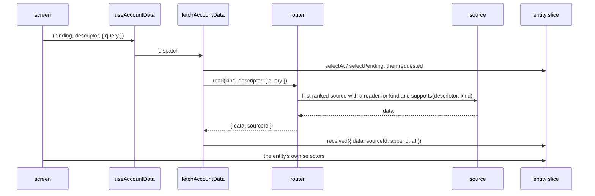

# Account data layer

A screen asks for one kind of data of one account (a balance, a page of operations) when it needs it, instead of reading a monolithic `Account` filled by the background sync. The router picks, per account, the first source able to serve it, and the answer lands in that kind's entity slice.

Accounts are identified by an `AccountDescriptor` and keyed by its `AccountUUID`, both from [`@domain/entity-account-descriptor`](../domain/entity/account-descriptor).

## Packages

| Package | Holds |
| --- | --- |
| [`@domain/entity-account-data`](../domain/entity/account-data) | `AccountDataRegistry`, the open map of kinds, and `AccountDataBinding`. Types only |
| [`@domain/api-account-data-source`](../domain/api/account-data-source) | `AccountDataSource`, `createAccountDataRouter`, `fetchAccountData`, `fetchAccountDataBatch`; `./testing` holds two toy kinds |
| [`@features/platform-account-data`](../features/platform/account-data) | `useAccountData` |
| `@domain/entity-account-*` | one kind each: models, slice, binding, and the `declare module` adding the kind |
| apps, `src/config/account-data-setup.ts` | the ranked sources, spread into the thunk `extraArgument` |

No framework package depends on an entity or a source: entities and sources plug in without touching each other.

## Read flow



- **Freshness.** A head read of the same query younger than `maxAge` (30 s by default) is skipped. `refresh` reads whatever the age. Data restored from an earlier session is read once again, its query being unknown.
- **Latest wins.** A read answering after a newer head read of the same account started is dropped, so neither an old query nor an old next page lands on top of a fresh head.
- **One read in flight** per account and kind: a second head read joins the first.
- **Next page.** `loadMore` asks `binding.selectNextQuery` for the next query, only of the query whose head is stored, and only the source that answered it: a cursor means nothing elsewhere.
- **Many accounts.** Reads issued in the same tick for one kind and query are routed together: one call per chunk of `maxBatchSize` on a source with a batch reader, otherwise its single reader once per account. Either way, at most `concurrency` calls (default 4) are in flight per source. `fetchAccountDataBatch` is the explicit form, for a "refresh all".
- **Failures** are per account: an account no source serves fails with `NoAccountDataSourceError`; a failed batch call fails its chunk only, without retrying account by account.

## Adding an entity

In a new `domain/entity/account-<kind>` package:

1. Declare the kind:

   ```ts
   declare module "@domain/entity-account-data" {
     interface AccountDataRegistry {
       staking: { query: undefined; result: AccountStaking };
     }
   }
   ```

2. Write the slice: it stores the result, a pending flag, the error and the `sourceId`, keyed by `AccountUUID`. `received` carries `append`: replace on a head read, merge on a next page.
3. Export an `AccountDataBinding<"staking", WithStakingState>` over its actions and selectors. A paginated kind also implements `selectNextQuery`.
4. Register the reducer in each app.

[`newKind.test.tsx`](../features/platform/account-data/src/newKind.test.tsx) does all of this in one file.

## Adding a source

Per kind, a source implements either a single reader or a batch reader.

A single reader, for an API that takes one account. The router calls it once per account, at most `concurrency` at once (4 by default):

```ts
export const explorerSource: AccountDataSource = {
  id: "explorer",
  supports: (descriptor, kind) => kind === "balance",
  concurrency: 2,
  read: {
    balance: async (target, query, signal) => fetchBalance(target.descriptor, signal),
  },
};
```

A batch reader, only for a real multi-account call. The router answers a single read with a batch of one, and merges the reads of one tick into chunks of `maxBatchSize`:

```ts
export const portfolioSource: AccountDataSource = {
  id: "portfolio",
  supports: (descriptor, kind) => kind === "balance" && isEvm(descriptor.network),
  maxBatchSize: 100,
  readBatch: {
    balance: async (targets, query, signal) => fetchBalances(targets, signal), // one settled result per target, in order
  },
};
```

- `supports` is pure and synchronous, decided from the descriptor alone.
- A source with both readers for a kind is always read through `readBatch`: its `read` is never called.
- Add the source to `accountDataSources` in each app's `account-data-setup.ts`. The order is the fallback order.

Without React or Redux, `router.read(kind, descriptor)` and `router.readBatch(kind, descriptors)` answer the same.
