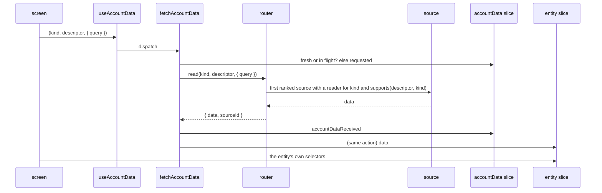

# Account data layer

A screen asks for one kind of data of one account (a balance, a page of operations) when it needs it, instead of reading a monolithic `Account` filled by the background sync. The router picks, per account, the first source able to serve it; the answer lands in that kind's entity slice, and how the read went in the framework's `accountData` slice.

Accounts are identified by an `AccountDescriptor` and keyed by its `AccountUUID`, both from [`@domain/entity-account-descriptor`](../domain/entity/account-descriptor). The accounts of the app live in the `accounts` slice of [`@domain/entity-account`](../domain/entity/account), by `AccountUUID` (each app mounts it at `accountEntries` while the legacy store holds `accounts`, and binds its selectors there), kept in step with the legacy accounts by `connectAccountsStore` (wired in each app's `account-data-setup.ts`), so a screen holding a legacy account finds its descriptor with `selectAccountUUIDByLegacyId`.

## Packages

| Package | Holds |
| --- | --- |
| [`@domain/entity-account-data`](../domain/entity/account-data) | `AccountDataRegistry`, the open map of kinds; the `accountData` status slice and the `accountDataReceived` action entities store from |
| [`@domain/api-account-data`](../domain/api/account-data) | `AccountDataSource`, `createAccountDataRouter`, `fetchAccountData`, `fetchMoreAccountData`; `./testing` holds two toy kinds |
| [`@features/platform-account-data`](../features/platform/account-data) | `useAccountData` |
| `@domain/entity-account-<kind>` | one kind: its models, its data slice, and the `declare module` adding the kind |
| apps, `src/config/account-data-setup.ts` | the ranked sources, spread into the thunk `extraArgument` |

No framework package depends on an entity or a source: entities and sources plug in without touching each other.

## Read flow



- **Status.** `accountData[kind][accountUUID]` holds the read in flight, the last error (`{ name, message }`), and the `sourceId`, query and time of the stored data. One action stores both the data and its status, so they never disagree. It is not persisted: data restored from an earlier session is read once again.
- **Freshness.** A head read of the stored query younger than `maxAge` (30 s by default) is skipped; one already in flight is joined. `refresh` reads whatever the age.
- **Latest wins.** An answer arriving after a newer read of the same account started is dropped.
- **Next page.** A paginated kind's result carries `nextCursor`, opaque to everyone but the source that wrote it. `fetchMoreAccountData` hands it back to that source only, for the stored head's query.
- **Many accounts.** Reads issued in the same tick for one kind, query and source are routed together: one call per chunk of `maxBatchSize` on a source with a batch reader, otherwise its single reader once per account. Either way, at most `concurrency` calls (default 4) are in flight per source. "Refresh all" is one `fetchAccountData` per account, dispatched in one go.
- **Failures** are per account: an account no source serves fails with `NoAccountDataSourceError`; a failed batch call fails its chunk only, without retrying account by account.

Why not RTK Query: its cache would hold the data, where entity slices are what screens and other domains select from, keyed by `AccountUUID`. It also caches per endpoint argument, so it cannot merge the reads of many screens into one source call, nor fall back between sources per account.

## Adding an entity

In a new `domain/entity/account-<kind>` package:

1. Declare the kind. A paginated kind's result has `nextCursor?: string`:

   ```ts
   declare module "@domain/entity-account-data" {
     interface AccountDataRegistry {
       staking: { query: undefined; result: AccountStaking };
     }
   }
   ```

2. Write the slice: it stores the data keyed by `AccountUUID`, from the answers of its kind. `append` is `true` on a next page, to merge rather than replace:

   ```ts
   extraReducers: builder => {
     builder.addMatcher(isAccountDataReceived("staking"), (state, { payload }) => {
       state[payload.accountUUID] = payload.data;
     });
   },
   ```

3. Register the reducer in each app, next to `accountData`.

[`newKind.test.tsx`](../features/platform/account-data/src/newKind.test.tsx) does all of this in one file.

## Adding a source

Per kind, a source implements either a single reader or a batch reader.

A single reader, for an API that takes one account. The router calls it once per account, at most `concurrency` at once (4 by default):

```ts
export const explorerSource: AccountDataSource = {
  id: AccountDataSourceIdSchema.parse("explorer"),
  supports: (descriptor, kind) => kind === "balance",
  concurrency: 2,
  read: {
    balance: async target => fetchBalance(target.descriptor),
  },
};
```

A batch reader, only for a real multi-account call. The router answers a single read with a batch of one, and merges the reads of one tick into chunks of `maxBatchSize`:

```ts
export const portfolioSource: AccountDataSource = {
  id: AccountDataSourceIdSchema.parse("portfolio"),
  supports: (descriptor, kind) => kind === "balance" && isEvm(descriptor.network),
  maxBatchSize: 100,
  readBatch: {
    balance: async targets => fetchBalances(targets), // one settled result per target, in order
  },
};
```

- `id` is an `AccountDataSourceId` (`AccountDataSourceIdSchema` in `@domain/entity-account-data`): the answering source is stored with the data, and only it serves the next page.
- `supports` is pure and synchronous, decided from the descriptor alone.
- `purposes` lists the descriptor purposes a source serves, `["account"]` by default: a `mock` descriptor (a generated account) only reaches the mock source of [`@devtools/mock-accounts`](../devtools/mock-accounts), which that tool adds at runtime with `addAccountDataSource`.
- On a next page, each target carries the `cursor` the source wrote in the previous page's `nextCursor`.
- A source with both readers for a kind is always read through `readBatch`: its `read` is never called.
- Add the source to `accountDataSources` in each app's `account-data-setup.ts`. The order is the fallback order.

Without React or Redux, `createAccountDataRouter(sources).read(kind, descriptor)` answers the same.
