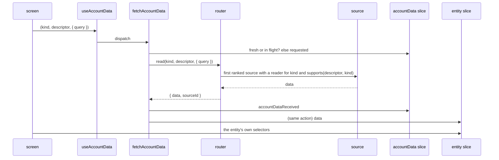
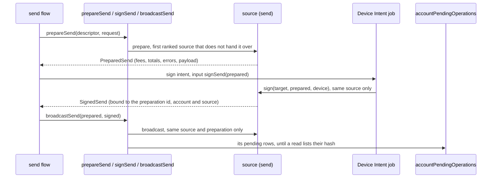

# Account data layer

A screen asks for one kind of data of one account (a balance, a page of operations) when it needs it, instead of reading a monolithic `Account` filled by the background sync. The router picks, per account, the first source able to serve it; the answer lands in that kind's entity slice, and how the read went in the framework's `accountData` slice.

Accounts are identified by an `AccountDescriptor` and keyed by its `AccountUUID`, both from [`@domain/entity-account-descriptor`](../../domain/entity/account-descriptor). The accounts of the app live in the `accounts` slice of [`@domain/entity-account`](../../domain/entity/account), by `AccountUUID` (each app mounts it at `accountEntries` while the legacy store holds `accounts`, and binds its selectors there), kept in step with the legacy accounts by `connectAccountsStore` (wired in each app's `account-data-setup.ts`), so a screen holding a legacy account finds its descriptor with `selectAccountUUIDByLegacyId`.

## Packages

| Package | Holds |
| --- | --- |
| [`@domain/entity-account-data`](../../domain/entity/account-data) | `AccountDataRegistry`, the open map of kinds; the `accountData` status slice and the `accountDataReceived` action entities store from |
| [`@domain/api-account-data`](../../domain/api/account-data) | `AccountDataSource`, `createAccountDataRouter`, `fetchAccountData`, `fetchMoreAccountData`; `./testing` holds two toy kinds |
| [`@features/platform-account-data`](../../features/platform/account-data) | `useAccountData` for one account, `useAccountDataBatch` for many |
| [`@features/platform-account-source-coin-module`](../../features/platform/account-source-coin-module) | the `coin-module` source, reading coin modules directly (`balance`; `operations` once it lists pending operations) |
| `@domain/entity-account-<kind>` | one kind: its models, its data slice, and the `declare module` adding the kind |
| apps, `src/config/account-data-setup.ts` | the ranked sources, spread into the thunk `extraArgument` |

No framework package depends on an entity or a source: entities and sources plug in without touching each other.

## Read flow



- **Status.** `accountData[kind][accountUUID][queryKey]` holds the read in flight, the last error (`{ name, message }`), and the `sourceId` and time of the stored data. `queryKey` is `accountDataQueryKey(query)`: two screens reading one account with different queries (all operations, one token's) never replace each other's data. One action stores both the data and its status, so they never disagree. It is not persisted: data restored from an earlier session is read once again.
- **Queries.** Every source honours the whole query, in memory if it has to: `supports` does not see the query, so the router cannot route by it. The entity stores each query's answer under the `queryKey` of `accountDataReceived`, and its selectors take the query.
- **Freshness.** A head read of a query younger than `maxAge` (30 s by default) is skipped; one already in flight is joined. `refresh` reads whatever the age.
- **Latest wins.** An answer arriving after a newer read of the same account and query started is dropped.
- **Next page.** A paginated kind's result carries `nextCursor`, opaque to everyone but the source that wrote it. `fetchMoreAccountData` hands it back to that source only, for the same query.
- **Many accounts.** Reads issued in the same tick for one kind, query and source are routed together: one call per chunk of `maxBatchSize` on a source with a batch reader, otherwise its single reader once per account. Either way, at most `concurrency` calls (default 4) are in flight per source. `useAccountDataBatch` dispatches one `fetchAccountData` per account in one go, so each account keeps its own freshness, join and status while the source still gets one call per chunk.
- **Failures** are per account: an account no source serves fails with `NoAccountDataSourceError`; a failed batch call fails its chunk only, without retrying account by account. A source that cannot serve one account after all rejects it with `AccountDataNotServedError`: the router asks the next ranked source, each source at most once, except on a next page.

Why not RTK Query: its cache would hold the data, where entity slices are what screens and other domains select from, keyed by `AccountUUID`. It also caches per endpoint argument, so it cannot merge the reads of many screens into one source call, nor fall back between sources per account.

## Adding an entity

In a new `domain/entity/account-<kind>` package:

1. Declare the kind. A paginated kind's result has `nextCursor?: string`:

   ```ts
   declare module "@domain/entity-account-data" {
     interface AccountDataRegistry {
       staking: { query: undefined; result: AccountStaking };
     }
   }
   ```

2. Write the slice: it stores the data keyed by `AccountUUID`, from the answers of its kind. A kind with a query also keys it by `payload.queryKey` (see [`@domain/entity-account-operation`](../../domain/entity/account-operation)). `append` is `true` on a next page, to merge rather than replace:

   ```ts
   extraReducers: builder => {
     builder.addMatcher(isAccountDataReceived("staking"), (state, { payload }) => {
       state[payload.accountUUID] = payload.data;
     });
   },
   ```

3. Register the reducer in each app, next to `accountData`.

[`newKind.test.tsx`](../../features/platform/account-data/src/newKind.test.tsx) does all of this in one file.

## Adding a source

Per kind, a source implements either a single reader or a batch reader.

A single reader, for an API that takes one account. The router calls it once per account, at most `concurrency` at once (4 by default):

```ts
export const explorerSource: AccountDataSource = {
  id: AccountDataSourceIdSchema.parse("explorer"),
  supports: (descriptor, kind) => kind === "balance",
  concurrency: 2,
  read: {
    balance: async target => fetchBalance(target.descriptor),
  },
};
```

A batch reader, only for a real multi-account call. The router answers a single read with a batch of one, and merges the reads of one tick into chunks of `maxBatchSize`:

```ts
export const portfolioSource: AccountDataSource = {
  id: AccountDataSourceIdSchema.parse("portfolio"),
  supports: (descriptor, kind) => kind === "balance" && isEvm(descriptor.network),
  maxBatchSize: 100,
  readBatch: {
    balance: async targets => fetchBalances(targets), // one settled result per target, in order
  },
};
```

- `id` is an `AccountDataSourceId` (`AccountDataSourceIdSchema` in `@domain/entity-account-data`): the answering source is stored with the data, and only it serves the next page.
- `supports` is pure and synchronous, decided from the descriptor alone.
- `purposes` lists the descriptor purposes a source serves, `["account"]` by default: a `mock` descriptor (a generated account) only reaches the mock source of [`@devtools/mock-accounts`](../../devtools/mock-accounts), which that tool adds at runtime with `addAccountDataSource`.
- On a next page, each target carries the `cursor` the source wrote in the previous page's `nextCursor`.
- A source with both readers for a kind is always read through `readBatch`: its `read` is never called.
- Add the source to `accountDataSources` in each app's `account-data-setup.ts`. The order is the fallback order: `coin-module` first, then `full-sync`.

Without React or Redux, `createAccountDataRouter(sources).read(kind, descriptor)` answers the same. Its `sourcesFor(descriptor)` gives the ranked sources serving the descriptor's purpose, for a capability other than reads to follow the same ranking.

## Sending

A source that sends from the accounts it supports adds `send` (`AccountSendCapability` of [`@domain/api-account-transaction`](../../domain/api/account-transaction)) next to its readers, on the same object: the router's `sourcesFor(descriptor)` gives the ranked sources serving the descriptor's purpose, so `mock` accounts only reach the mock source.



- Values, not ids: the flow keeps the `PreparedSend` and the `SignedSend`. `broadcastSend` rejects a signature of another preparation, account or source with `SignatureMismatchError`, and each source checks it again on its own payloads.
- `estimateSendFees` gives each fee preset's cost for a fee picker, and `releaseSend` frees a preparation the flow abandons or replaces.
- Payloads are the source's own. FullSync keeps the family's objects in memory behind handles namespaced per sender instance, held 30 minutes after their last use; a restart means preparing again. Concurrent broadcasts of one signature share one network call.
- `selectAccountOperationsWithPending` heads a window with the pending rows no stored row lists by hash, whatever order the read and the broadcast came in, and only those of the window's `filterAsset`.

### What a send request covers

| Send flow need | `SendRequest` / capability |
| --- | --- |
| Asset, recipient, amount, send max | `assetId`, `recipient`, `amount`, `useAllAmount` |
| ENS or other domain | `recipientDomain` (display), the resolution object a family signs with in `familyOptions` |
| Fee presets and their values | `feeStrategy` (any preset id of the send descriptor), `estimateSendFees` |
| Custom fees | `feeStrategy: "custom"` + `customFees`, the descriptor's custom fee input values |
| Pay fees in another asset | `feeAssetId`: FullSync maps it through the descriptor's `customAssets`, otherwise `FeeAssetNotSupported` |
| Memo, tag, typed memo | `memo: { value, type? }`, the descriptor's default memo type when `type` is absent |
| Coin control, balance pool, self transfer, sponsored flag | `familyOptions`, applied as a patch by the sources that know the family |
| Validation as the user types | `errors` / `warnings` with `field` and translation `params` |
| Device refusal and retry | `SignatureRefusedError` → the sign intent's `cancelled` + `retry`, same preparation |

### Pending operations and the nonce

The domain `accountPendingOperations` slice is what the new screens show. FullSync also keeps adding the optimistic operation to the legacy account's `pendingOperations`, which is what its families read to pick the next nonce (EVM) or to skip spent inputs (UTXO): a second send prepared before any read lists the first one still gets the next nonce. A source that does not go through the legacy account owns its nonce: it reads it from the network at `prepare` and counts its own broadcasts not yet listed.

