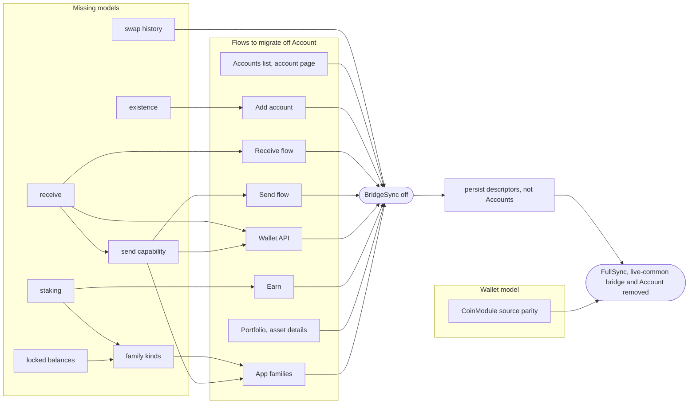

# Migrating off the legacy Account

The goal: no code path needs the `Account` type of [`@ledgerhq/types-live`](../../libs/types-live/README.md). Then BridgeSync stops, and FullSync, the live-common bridge and the type go with it. Each step ships on its own, one kind, one screen, one family at a time.

Tracking: the [Account Sunset Plan](https://claude.ai/artifact/GnUC4hibqtG6V26ntgwY3W) (topics, sources, open questions), the [Account Sunset Map](https://claude.ai/artifact/QLnzYBZxzvCpjBbWXJdFPs) (teams and dependencies) and the discovery epic [LIVE-40834](https://ledgerhq.atlassian.net/browse/LIVE-40834).

## Rules while both models live

- New code takes an `AccountDescriptor` or an `AccountUUID`, never an `Account`, `TokenAccount` or `AccountLike`.
- A legacy screen holding an `Account` crosses over with `selectAccountUUIDByLegacyId`, then reads entities. The legacy id never enters a new slice, route or analytics event.
- A missing kind follows the recipe: entity package, FullSync reader, screen, DevTools tool, then faster sources. Only the entity blocks the rest ([data-layer.md](./data-layer.md#adding-an-entity)).
- FullSync stays the fallback source until every kind has another source for every family.
- A field no screen reads is not carried over.

## The Wallet API migrates too

The Wallet API exposes accounts to live apps, so it moves to the entities as well: `account.list` and `account.request` built from `accounts`, `account-name`, `account-balance` and `account-receive` ([#24517](https://github.com/LedgerHQ/ledger-live/pull/24517)), the server core out of live-common ([#24538](https://github.com/LedgerHQ/ledger-live/pull/24538)), then signing and broadcasting through the `send` capability ([#24539](https://github.com/LedgerHQ/ledger-live/pull/24539)). These are PoCs behind the `walletApiAccountData` flag. Live apps keep the account ids they already store. Still to decide: what replaces `blockHeight` and `lastSyncDate`.

## Where each Account field goes

| `Account` field | Goes to | State |
| --- | --- | --- |
| `id`, `type`, `parentId`, `xpub`, `derivationMode`, `index` | `AccountDescriptor`, `AccountUUID` | merged |
| `balance`, `spendableBalance`, `subAccounts` | `balance`, tokens as rows | merged |
| `operations` | `operations` | merged |
| `operationsCount` | nothing yet: a loaded window of `operations` is partial, its length is not the total | to decide |
| `Operation.extra` (memo, validator, votes…) | dropped for now; to revisit as part of `AccountOperation` | dropped |
| `balanceHistoryCache` | `balanceHistory` | merged |
| name, alias, star, order | `account-name`, `account-alias`, `starred-account`, the `accounts` slice | merged |
| `used` | `existence` | discovery |
| `freshAddress`, `freshAddressPath` | `receive` | discovery |
| `pendingOperations`, `sequence` | `send` capability, pending rows in `operations` | discovery |
| `stakingResources`, staking parts of family resources | a staking kind, validators in a network entity | to explore |
| reserved, frozen, locked parts of resources | a breakdown in `balance` | to explore |
| other family resources | kinds declared by each family | to explore |
| `swapHistory` | an app-owned swap entity, not a kind | to explore |
| `currency`, `feesCurrency`, `token` | derived from `network` and `assetId` | helpers |
| `lastSyncDate`, `blockHeight`, `syncHash`, `creationDate`, `nfts` | dropped; read time is in the `accountData` status | to decide |
| `seedIdentifier` | kept in the account entry, or dropped | to decide |

## What must be solved, in which order

An arrow means "is needed by". Everything without an incoming arrow can start now.

- The three discovery tasks (existence, receive, send) unblock the most consumers: start there.
- Staking, locked balances, swap history and CoinModule parity do not wait on anything.
- Persisting descriptors instead of Accounts is the goal, not a blocker: until then, the `accounts` slice mirrors the legacy accounts, and every item above works on it.
