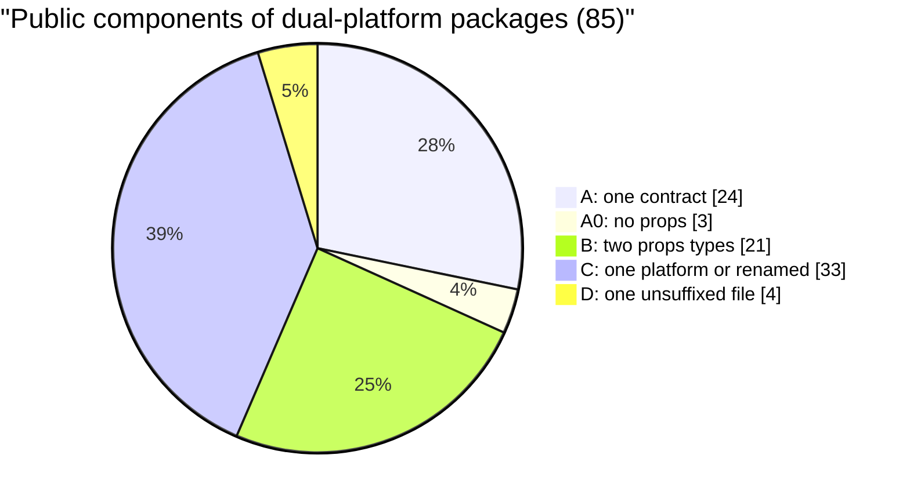
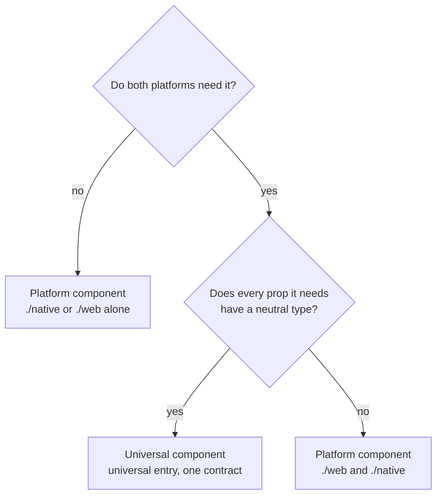
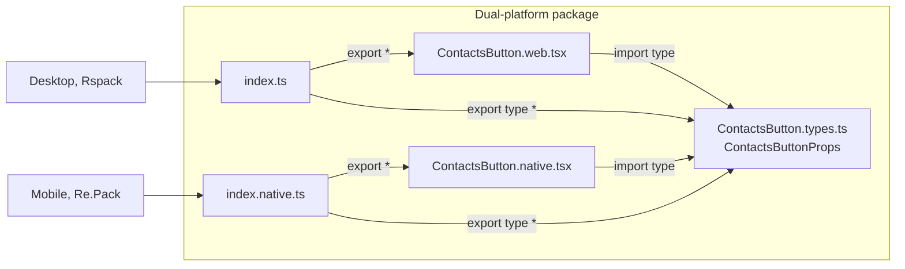
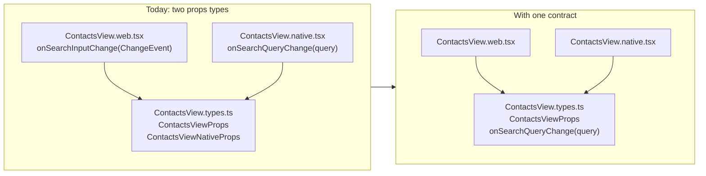
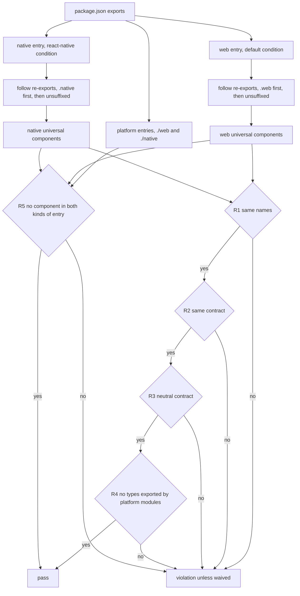
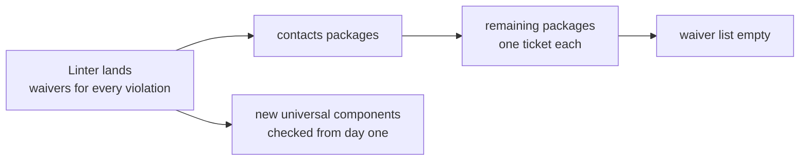

# ADR: One props contract per public universal component

**Status:** Proposed

## Context

The public API of a dual-platform package has two shapes today: 54 of its 85 public components either declare two props types or exist on one platform only. A consumer importing `ContactsButton` from `@features/flow-contacts` gets `onClick` on desktop and `onPress` on mobile, so the single entry point that `@features/*` packages promise does not hold.

This ADR uses these terms:

- A **dual-platform package** resolves its public API per platform: it has a `react-native` condition in `package.json#exports`, a `./web` or `./native` subpath, or `.web` / `.native` files reachable from an entry.
- A **universal entry** is an entry of `package.json#exports` that resolves per platform: it has a `react-native` condition, such as `.`, or it has no condition and its exports resolve to different modules on web and on native. A **platform entry** is a `./web` or `./native` subpath without a condition, so the importer names the platform.
- A **universal component** is a React component exported from a universal entry. A **platform component** is one exported from a platform entry.
- A **contract** is the unsuffixed module that declares the props type of a universal component.

Two causes produce the divergence. Lumen ships as two packages, `@ledgerhq/lumen-ui-react` (0.1.61) and `@ledgerhq/lumen-ui-rnative` (0.1.64), and neither shares a props package with the other: `@ledgerhq/lumen-design-core` (0.1.30) exports themes and presets only. Variant props such as `appearance` and `size` match across the two, while base props differ (`onClick`, `className`, `data-testid` on web; `onPress`, `lx`, `testID` on native). An author who types a feature component after the Lumen component it wraps inherits that split.

The second cause is [docs/tsconfig.md](../tsconfig.md), which used to state that "Platform-specific props are safe" and gave `React.CSSProperties` against `ViewStyle` as the example. The 2026-08-27 discussion on the web and native split names this line as the probable origin of the pattern.

Measured on develop `d5fe20dc9d7` across 33 dual-platform packages:



| Class | Count | Shape                                                                | Example                                                                            |
| ----- | ----- | -------------------------------------------------------------------- | ---------------------------------------------------------------------------------- |
| A     | 24    | One props type in an unsuffixed module, used by both implementations | `shared/ui-qr-code/src/types.ts`                                                   |
| A0    | 3     | No props on either platform                                          | `MarketBanner` in `features/flow/market-banner`                                    |
| B     | 21    | Same name, two props types                                           | `ContactsView.types.ts` declares `ContactsViewProps` and `ContactsViewNativeProps` |
| C     | 33    | One platform only (21 native, 6 web), or one name per platform (6)   | `ContactDetailActions` on web, `ContactDetailActionsMenu` on native                |
| D     | 4     | One unsuffixed file for both platforms                               | `Track` in `shared/analytics-react`                                                |

Three divergences account for most of class B and the renamed pairs of class C. Native sheet props (`bottomInset`, `bottomOffset`, `autoFocus`) appear on 15 components. Input callbacks take a DOM event on web and a value on native, or use `onClick` against `onPress`, on 6. Six more share almost no props between platforms. Test ids differ as a prop on one component only; elsewhere the split sits in hard-coded JSX.

Callback names carry the same platform vocabulary. Across `features/` and `shared/`, internal components included, 123 callback prop declarations (33 distinct names) use a gesture name, led by `onPress` (39), `onClick` (12) and `onTransactionPress` (10). The other 622 (158 distinct names) name an intent, such as `onClose`, `onEdit` or `onSelectAddress`. Both groups average 11 characters per name (11.2 and 11.0).

Some components cannot share an API, and nothing says where they go. On develop `991664cf76e`, `@shared/lottie` wraps a different player per platform: its web props take `CSSProperties`, `className` and a layout tuple, its native props take `StyleProp<ViewStyle>` and accept a bundler asset id as `source`. `features/flow/pay-card-widget` exposes its Apple and Google Wallet components, which have no desktop counterpart, through a `./native` subpath next to its universal `.` entry. Eight other packages, the seven contacts packages and `shared/ui-info-state`, also expose `./native`, but it points at the same module as `.` on native, so the same components are reachable through two entries.

## Decision

Every universal component has exactly one contract, and a rule in `lint:structure` enforces it. Components that the public API does not export stay free to diverge.

A public component takes one of three shapes, and its shape decides its entry:



- **Universal**, the default. Both platforms need the component, and every prop it cannot work without has a neutral type. It is exported from a universal entry and follows R1 to R4.
- **Platform, on both platforms.** Both platforms need the component, but a prop it cannot work without has no neutral type: the style of the surface it renders, or an asset reference whose shape the bundler decides. `Lottie` is the case. It is exported from `./web` and from `./native`, each with its own props type, and each importer names its platform.
- **Platform, on one platform.** Only one platform needs the component, such as `AddToWalletCta` in `pay-card-widget`. It is exported from `./native` or `./web` alone, unless it can stay internal or move to the app that renders it.

A platform entry is an exit for a component that cannot be universal, not a shortcut around the contract. A prop that is awkward to make neutral is not a reason: keep the quirk in the implementation, or add an optional `@platform` prop (below).



```ts
// ContactsButton.types.ts, the contract
export type ContactsButtonProps = Readonly<{
  title: string;
  description: string;
  newBadgeLabel?: string;
  onOpenContacts: () => void;
  testID?: string;
}>;
```

```tsx
// ContactsButton.web.tsx
import type { ContactsButtonProps } from "./ContactsButton.types";

export function ContactsButton({ title, description, newBadgeLabel, onOpenContacts, testID }: ContactsButtonProps) {
  return (
    <Card type="interactive" onClick={onOpenContacts} data-testid={testID}>
      {/* same tree as native */}
    </Card>
  );
}

// ContactsButton.native.tsx is identical apart from the Lumen import and
// <Card type="interactive" onPress={onOpenContacts} testID={testID}>
```

The barrels export the component and the contract: `export * from "./ContactsButton"` and `export type * from "./ContactsButton.types"`.

Four rules apply to every universal component:

1. **Parity (R1).** The component is exported on both platforms under the same name. A component that one platform does not need leaves the universal entry: it moves to a platform entry, becomes internal, or moves to the app that renders it.
2. **One contract (R2).** Both implementations annotate their first parameter with the same type name, imported from the same contract; `Readonly<X>` around it is accepted. The contract declares the type itself instead of re-exporting it, and has no platform-suffixed sibling (`.web`, `.native`, `.ios`, `.android`): `X.types.web.ts` would shadow `X.types.ts` on web without any error, as `ContactsAddAddressEntry.types.web.ts` does today. A component without props takes no parameter on either platform.
3. **Neutral contract (R3).** The contract imports nothing from `react-native*`, `@ledgerhq/lumen-ui-*` or `react-dom`, and references no DOM or React Native type (`ChangeEvent`, `SyntheticEvent`, `NativeSyntheticEvent`, `GestureResponderEvent`, `CSSProperties`, `ViewStyle`, `HTML*Element` and their kin). Callback props name the user's intent: `on` plus a verb, plus an object when the component exposes several actions or the verb alone is ambiguous (`onEdit`, `onOpenContacts`, `onSelectAddress`). Gesture and DOM event names are rejected: any name containing the word `Click`, `Press`, `Tap`, `Touch`, `Mouse` or `Pointer` (`onPress`, `onEditPress`), and `onChange`, `onChangeText`, `onSubmit`, `onFocus`, `onBlur`, `onKey*`. Callbacks receive the value an event carries, never the event object, as in `onSearchQueryChange(query: string)`. The test id is `testID`. The contract declares no `className` or `style` prop, and no ref to a DOM element or a native view: a component that needs imperative access declares a handle type in the contract and exposes `ref?: Ref<XHandle>`, which each implementation fills with `useImperativeHandle` (React 19 passes `ref` as a regular prop). Each implementation maps the intent in one line: `onClick={onOpenContacts}` on web, `onPress={onOpenContacts}` on native.
4. **Types in the contract only (R4).** A `.web` or `.native` module reachable from the public API exports its component and nothing else, so the public API carries each props type once.

A fifth rule applies to every public component of a dual-platform package:

5. **One entry per component (R5).** A component is exported from universal entries or from platform entries, never from both. A platform entry resolves to a module of its own that carries its platform's suffix, such as `nativeExports.native.ts`, so the other platform's typecheck never compiles it; it never points at a module that a universal entry resolves to. Only code of the same platform imports a platform entry: a `.native` or `.web` file, the app of that platform, or a single-platform package.

A platform quirk stays inside the implementation that has it. The safe area under a native sheet is the common case: [BankTransferIntroView.native.tsx](https://github.com/LedgerHQ/ledger-live/blob/d5fe20dc9d7d01ff185ec2ee84a4a60709096329/features/flow/pay-bank-transfer/src/components/BankTransferIntro/BankTransferIntroView.native.tsx#L156) reads it with `useBottomSheetBottomInset()` and exposes no prop, while the contacts sheets take a `bottomInset` prop that the [mobile app fills](https://github.com/LedgerHQ/ledger-live/blob/d5fe20dc9d7d01ff185ec2ee84a4a60709096329/apps/ledger-live-mobile/src/mvvm/features/Contacts/screens/ContactDetail/components/ContactAddressDetailActionsSheets/index.tsx#L21) with `useSafeAreaInsets().bottom`, a value the native implementation can read itself.

A prop that only one platform reads goes in the contract only when the caller alone knows its value, and under three conditions:

- it is optional, and the other implementation ignores it;
- its type is `boolean`, `number`, `string` or a union of string literals;
- its JSDoc carries `@platform native` or `@platform web`.

Every platform-only prop found today (`bottomInset`, `bottomOffset`, `autoFocus`) is a `number` or a `boolean`. A few are required, and stay waived until they become optional.

A component whose `@platform` props outnumber its shared props is not universal either: it moves to platform entries instead of growing a contract that each platform reads half of.



## Enforcement

A rule in [tools/nx-plugins/enforce-package-structure/](../../tools/nx-plugins/enforce-package-structure/) runs under the existing `lint:structure` target, which [test-boundaries-reusable.yml](../../.github/workflows/test-boundaries-reusable.yml) already runs on every pull request touching `shared/`, `domain/` or `features/`.



- The rule reads the entries from `package.json#exports` and resolves each one twice, the way the two app bundlers do. Desktop builds with Rspack: `default` condition, `.web` before the unsuffixed file. Mobile builds with Re.Pack 5.2.5 (`Repack.getResolveOptions` with `preferNativePlatform: true` in [rspack.config.mjs](../../apps/ledger-live-mobile/rspack.config.mjs)): `react-native` condition, `.ios` or `.android`, then `.native`, then the unsuffixed file. No `.ios` or `.android` file exists under `features/`, `shared/` or `domain/` today; the rule treats one as a native variant. It follows re-exports to the module that declares each export.
- An entry without a condition counts as universal when its two resolutions differ: a different set of export names, or a different declaring module for one of them. An entry that resolves the same on both platforms, such as one that imports `./View.web` explicitly, is not universal and the rule skips it.
- It parses modules with the TypeScript parser (`ts.createSourceFile`) and builds no program, so it runs on the root dev dependencies that the boundaries job installs. [enforce-i18n-keys/validate.js](../../tools/nx-plugins/enforce-i18n-keys/validate.js) is the existing precedent for the TypeScript API in an nx plugin.
- It treats as a component every PascalCase named export of a `.tsx` module that is a function: a declaration, an arrow function, or a `memo(...)` or `forwardRef(...)` call. A `createContext` result is not a function and is skipped.
- Within R3, a prop whose JSDoc carries `@platform` must be optional and typed `boolean`, `number`, `string` or a union of string literals. The parser reads JSDoc tags (`ts.getJSDocTags`) without a type checker. An untagged platform-only prop looks like any other prop and passes; review catches it, as it catches the "outnumber" heuristic above.
- For R5, the rule also resolves each platform entry and collects the components it exports. It reports a component exported from both a universal entry and a platform entry, and a platform entry that resolves to a module of a universal entry or to a module without its platform's suffix. Components of platform entries skip R1 to R4.
- The import side of R5 belongs to the `no-platform-suffix` rule of `@support/lint-rules`, which the platform-suffix cleanup extends to subpaths. It allows `/native` subpaths of `@features/*` and `@shared/*` packages only from native code (a `.native` file, the mobile app, a native-only package), the mirror for `/web`, and reports every other import. Without it, a web file that imports `@shared/lottie/native` puts `lottie-react-native` in the desktop bundle.
- The target's `inputs` widen from `src/**/index*` to `src/**/*.{ts,tsx}` and `package.json`, so a change to a component file invalidates the cache.
- Waivers live in `exceptions.js`, keyed by package and component. Each one carries an exit condition, which the plugin's existing test already requires of every exception.

The linter checks the convention; the two typecheck passes (`tsconfig.web.json`, `tsconfig.native.json`) check each implementation against the contract. Neither checks that an implementation reads every prop of its contract.

## Alternatives considered

| Option                                                                                                                       | Why not                                                                                                                                                                                                                                                          |
| ---------------------------------------------------------------------------------------------------------------------------- | ---------------------------------------------------------------------------------------------------------------------------------------------------------------------------------------------------------------------------------------------------------------- |
| B. Unsuffixed facade: a public `X.tsx` renders an internal `XView.web.tsx` or `XView.native.tsx`                             | One contract by construction, checkable by a file-system rule. Every universal component pays one extra module and one extra component layer, for the guarantee the contract convention gets from the linter.                                                    |
| C. Typed component signature: the contract declares `XComponent` and each platform writes `export const X: XComponent = ...` | The exported type is identical by construction, but it forces arrow functions where the repo writes function declarations, and the linter still has to require the annotation.                                                                                   |
| D. Public API parity through the type checker, without a file convention                                                     | It builds two programs per package (about 58 s for 38 packages in a local prototype), needs `@types/react` so it cannot run in the boundaries job, and still needs heuristics for contexts, `memo` and generic props.                                            |
| `onPress` on every interactive prop, as proposed in the 2026-08-27 discussion                                                | Both platforms get the same name, but the name is the React Native gesture: desktop users click or press Enter, so the contract still describes one platform's input. An intent name tells the consumer what the callback is for, and costs no length (Context). |
| A `@shared/ui` wrapper over every Lumen component                                                                            | Rejected in the 2026-08-27 discussion: each Lumen release needs a second change in the wrapper, and type inference degrades without carefully written generics.                                                                                                  |
| Status quo                                                                                                                   | Leaves 54 of 85 universal components with a per-platform API, and nothing stops a new one.                                                                                                                                                                       |

## Consequences

- The linter lands with waivers for every current violation, keyed by package and component, plus the contracts that pass every other rule but use a gesture name, such as `onPress` in [ActionTiles/types.ts](https://github.com/LedgerHQ/ledger-live/blob/d5fe20dc9d7d01ff185ec2ee84a4a60709096329/features/flow/pay-balance/src/components/ActionTiles/types.ts#L6).
- One ticket per package removes the waivers. The contacts packages go first: `features/flow/contacts`, the `flow-contacts-*` packages and `features/platform/contacts` hold most of them.
- [docs/tsconfig.md](../tsconfig.md) changes: platform-specific prop types stay inside an implementation and never reach a contract.
- Each migration ticket checks its platform-only props before tagging them. A `bottomInset` that the app fills from the safe area moves into the native implementation, as the pay packages already do, and leaves the contract.
- The eight packages whose `./native` subpath repeats their universal entry, the seven contacts packages and `shared/ui-info-state`, start with an R5 waiver. Their importers are native code, `.native` files or the native-only `app-*` packages, so each package either drops the subpath and its importers use the universal entry, or narrows the subpath to native-only components.
- `@shared/lottie` replaces its universal entry with `./web` and `./native`, and its importers, in the desktop app, the mobile app and `device-action-content`, name their platform. `pay-card-widget` already has the target shape.



### Positive

- A consumer gets one API per universal component. `ContactsButton` takes the same props on desktop and mobile, so the single entry point that `@features/*` packages promise holds.
- The linter blocks a new divergence from the day it lands, so review no longer has to catch it. The waiver list shows the remaining debt per package and per component, and shrinks as tickets land.
- The contract is the one place to read and change a component's API. A change to it reaches both platforms at once, and each app's typecheck flags the call sites to update.
- Callback names state what the callback is for. A view model that already names its handlers after intents, such as `onOpenContact` and `onAddContact` in `ContactsView.types.ts`, passes them through unchanged, and renaming a gesture name usually shortens it (`onEditPress` to `onEdit`).
- One `testID` prop serves the test selectors of both platforms.
- A component that cannot share an API has a defined home, a platform entry, so an author or a code generator does not improvise a half-neutral contract, and the import states the platform it serves. Single-platform UI such as the Wallet components of `pay-card-widget` stays in its package instead of moving to the app.
- The cost to start is low. 24 public components already follow the convention, the decision adds no runtime layer and no wrapper over Lumen, and the rule runs in the existing `lint:structure` job on root dev dependencies.

### Negative

- Each implementation carries mapping lines: the intent callback to the platform event (`onClick` on web, `onPress` on native), and `testID` to `data-testid` on web, one line per prop.
- A prop that one platform ignores compiles silently on that platform. The `@platform` tag says which platform reads it, but the linter only checks the shape of a tagged prop: it cannot find an untagged one, and neither the linter nor typecheck checks that an implementation reads every prop.
- "Outnumber" is a review heuristic, not a lint check, so a contract can drift toward one platform one prop at a time until a reviewer counts.
- The migration moves code. Single-platform components move to a platform entry (21 native-only and 6 web-only exports today), 6 renamed pairs merge into one name, and renaming a gesture-named callback touches every caller.
- A platform entry needs no contract, so it costs less than a universal entry. The linter checks that a component has one entry, not that it earned a platform entry; review does.
- Code shared by both platforms cannot import a platform component directly. It splits into `.web` and `.native` files first, as `device-action-content` already does around `Lottie`.
- The linter checks names and modules, not types. A DOM type reached through a local alias in another module escapes R3, and whether a callback name states a real intent stays a review question.
- The rule adds tooling to maintain. Its resolver mirrors Rspack on desktop and Re.Pack on mobile, and has to follow any change to the resolution of either bundler.
- The decision departs from the `onPress` convention of the 2026-08-27 discussion, so public contracts that adopted it rename their callbacks.

### Out of scope

- Internal components, which no entry of `package.json#exports` reaches.
- Single-platform packages, such as the native-only `features/flow/app-*` packages.
- Test support entries, whose subpath has a segment starting with `test` or `mock`, such as `./testing` or `./testing/module-mock`. They serve test setups, not app code.
- A `@shared/ui` package that re-exports Lumen per platform. It removes duplicated import lines inside implementations and leaves the public contract unchanged, so it needs a decision of its own.
- Suffixed import specifiers, such as `./X.native` or a relative `native.ts` barrel, which the platform-suffix cleanup removes. A platform entry is a package subpath, not a suffix, and the cleanup's subpath check allows it from code of the same platform (R5).

## Authoring a universal component

Start from the three shapes in Decision. A universal component is the default; a platform component follows the next section.

1. Write the contract `X.types.ts` next to the implementations, with one exported props type and neutral types only.
2. Keep platform quirks inside the implementation that has them: a native sheet reads its bottom inset with `useBottomSheetBottomInset()` or `useSafeAreaInsets()` instead of taking a prop. Add a platform-only prop to the contract only when the caller alone knows its value, as an optional primitive tagged `@platform native` or `@platform web`.
3. Count the tagged props. If they outnumber the shared ones, the component is not universal: author it as a platform component.
4. Import the contract with `import type` in `X.web.tsx` and `X.native.tsx`, and annotate the first parameter with it.
5. Name each callback after the user's intent (`onOpenContacts`), pass it the value rather than the event, and map it and `testID` to the platform props inside each implementation.
6. When a consumer needs imperative access, declare a handle type in the contract and fill it with `useImperativeHandle` on each platform. Never expose the underlying element.
7. Export the component from the barrels with `export * from "./X"`, and the type with `export type * from "./X.types"`.
8. Run `pnpm exec nx run <project>:lint:structure` and both typecheck passes.

An illustrative search field that combines the three cases: a value-only callback, a platform-only prop and a neutral handle.

```ts
// ContactsSearch.types.ts, the contract
import type { Ref } from "react";

export type ContactsSearchHandle = {
  focus(): void;
};

export type ContactsSearchProps = Readonly<{
  query: string;
  onSearchQueryChange: (query: string) => void;
  /** @platform native Space the host keeps above its tab bar, in px. */
  bottomOffset?: number;
  ref?: Ref<ContactsSearchHandle>;
  testID?: string;
}>;
```

```tsx
// ContactsSearch.native.tsx
import { useImperativeHandle, useRef } from "react";
import { TextInput, View } from "react-native";
import type { ContactsSearchProps } from "./ContactsSearch.types";

export function ContactsSearch({ query, onSearchQueryChange, bottomOffset = 0, ref, testID }: ContactsSearchProps) {
  const inputRef = useRef<TextInput>(null);
  useImperativeHandle(ref, () => ({ focus: () => inputRef.current?.focus() }));

  return (
    <View style={{ paddingBottom: bottomOffset }}>
      <TextInput ref={inputRef} value={query} onChangeText={onSearchQueryChange} testID={testID} />
    </View>
  );
}

// ContactsSearch.web.tsx holds a useRef<HTMLInputElement>, fills the same handle,
// passes event.target.value to onSearchQueryChange, and ignores bottomOffset.
```

R3 applies to the contract only. `TextInput`, `View` and `HTMLInputElement` appear in the implementations, where they belong.

## Authoring a platform component

1. Check the shape first. A prop that is awkward to make neutral, or a quirk the implementation can absorb, does not make a component a platform component.
2. Point `./native`, `./web` or both at a module of their own that carries the platform suffix, so the other platform's typecheck never compiles it. Never point a subpath at the module that the universal entry resolves to.
3. Export each props type next to its component; R2 to R4 do not apply. Keep the props that mean the same on both platforms in one shared type, as `LottieBaseProps` does.
4. Import the entry only from code of its platform. Shared code that needs the component splits into `.web` and `.native` files and imports one entry from each.

```jsonc
// shared/lottie: a platform component on both platforms, no universal entry
"exports": {
  "./web": "./src/index.web.ts",
  "./native": "./src/index.native.ts",
  "./package.json": "./package.json"
}

// features/flow/pay-card-widget (excerpt): universal components, plus native-only ones
"exports": {
  ".": { "react-native": "./src/index.native.ts", "default": "./src/index.ts" },
  "./native": "./src/nativeExports.native.ts",
  "./package.json": "./package.json"
}
```

## References

- Conforming code on develop `d5fe20dc9d7`:
  - [QrCodeProps](https://github.com/LedgerHQ/ledger-live/blob/d5fe20dc9d7d01ff185ec2ee84a4a60709096329/shared/ui-qr-code/src/types.ts#L3-L9), imported by [QrCode.web.tsx](https://github.com/LedgerHQ/ledger-live/blob/d5fe20dc9d7d01ff185ec2ee84a4a60709096329/shared/ui-qr-code/src/QrCode.web.tsx#L3-L13) and [QrCode.native.tsx](https://github.com/LedgerHQ/ledger-live/blob/d5fe20dc9d7d01ff185ec2ee84a4a60709096329/shared/ui-qr-code/src/QrCode.native.tsx#L5-L16), with `testID` mapped on [web](https://github.com/LedgerHQ/ledger-live/blob/d5fe20dc9d7d01ff185ec2ee84a4a60709096329/shared/ui-qr-code/src/QrCode.web.tsx#L24) and [native](https://github.com/LedgerHQ/ledger-live/blob/d5fe20dc9d7d01ff185ec2ee84a4a60709096329/shared/ui-qr-code/src/QrCode.native.tsx#L25)
  - [PayTrackPageProps](https://github.com/LedgerHQ/ledger-live/blob/d5fe20dc9d7d01ff185ec2ee84a4a60709096329/features/platform/pay-analytics/src/PayTrackPage.types.ts#L3-L8), imported by [PayTrackPage.web.tsx](https://github.com/LedgerHQ/ledger-live/blob/d5fe20dc9d7d01ff185ec2ee84a4a60709096329/features/platform/pay-analytics/src/PayTrackPage.web.tsx#L3-L5) and [PayTrackPage.native.tsx](https://github.com/LedgerHQ/ledger-live/blob/d5fe20dc9d7d01ff185ec2ee84a4a60709096329/features/platform/pay-analytics/src/PayTrackPage.native.tsx#L3-L5)
  - [CardProps](https://github.com/LedgerHQ/ledger-live/blob/d5fe20dc9d7d01ff185ec2ee84a4a60709096329/features/flow/pay-card/src/Card.types.ts#L21-L32) with intent callbacks, and [CardViewProps](https://github.com/LedgerHQ/ledger-live/blob/d5fe20dc9d7d01ff185ec2ee84a4a60709096329/features/flow/pay-card/src/Card.types.ts#L50-L66) shared by [CardView.web.tsx](https://github.com/LedgerHQ/ledger-live/blob/d5fe20dc9d7d01ff185ec2ee84a4a60709096329/features/flow/pay-card/src/CardView.web.tsx#L12) and [CardView.native.tsx](https://github.com/LedgerHQ/ledger-live/blob/d5fe20dc9d7d01ff185ec2ee84a4a60709096329/features/flow/pay-card/src/CardView.native.tsx#L7)
- Non-conforming code on develop `d5fe20dc9d7`:
  - R1: [ContactDetailActions](https://github.com/LedgerHQ/ledger-live/blob/d5fe20dc9d7d01ff185ec2ee84a4a60709096329/features/flow/contacts/src/steps/Detail/web.ts#L3-L4) on web against [ContactDetailActionsMenu](https://github.com/LedgerHQ/ledger-live/blob/d5fe20dc9d7d01ff185ec2ee84a4a60709096329/features/flow/contacts/src/steps/Detail/native.ts#L3-L4) on native
  - R2: [ContactsViewProps and ContactsViewNativeProps](https://github.com/LedgerHQ/ledger-live/blob/d5fe20dc9d7d01ff185ec2ee84a4a60709096329/features/flow/contacts/src/ContactsView.types.ts#L22-L32) in one file; [Dialog and Drawer props](https://github.com/LedgerHQ/ledger-live/blob/d5fe20dc9d7d01ff185ec2ee84a4a60709096329/features/flow/contacts/src/steps/Detail/components/ContactsDeleteAddressDialog/types.ts#L8-L19) that differ by `bottomInset?` only; [ContactsAddAddressEntry.types.web.ts](https://github.com/LedgerHQ/ledger-live/blob/d5fe20dc9d7d01ff185ec2ee84a4a60709096329/features/flow/flow-contacts-add-address/src/screens/AddressEntry/components/ContactsAddAddressEntry/ContactsAddAddressEntry.types.web.ts#L45) shadowing [ContactsAddAddressEntry.types.ts](https://github.com/LedgerHQ/ledger-live/blob/d5fe20dc9d7d01ff185ec2ee84a4a60709096329/features/flow/flow-contacts-add-address/src/screens/AddressEntry/components/ContactsAddAddressEntry/ContactsAddAddressEntry.types.ts#L10) on web
  - R3: [ChangeEvent](https://github.com/LedgerHQ/ledger-live/blob/d5fe20dc9d7d01ff185ec2ee84a4a60709096329/features/flow/contacts/src/ContactsView.types.ts#L24) in a contract; [onClick](https://github.com/LedgerHQ/ledger-live/blob/d5fe20dc9d7d01ff185ec2ee84a4a60709096329/features/flow/contacts/src/components/ContactsButton/ContactsButton.web.tsx#L19) on web against [onPress](https://github.com/LedgerHQ/ledger-live/blob/d5fe20dc9d7d01ff185ec2ee84a4a60709096329/features/flow/contacts/src/components/ContactsButton/ContactsButton.native.tsx#L19) on native
  - R4: props types exported from platform files, in [ContactsButton.web.tsx](https://github.com/LedgerHQ/ledger-live/blob/d5fe20dc9d7d01ff185ec2ee84a4a60709096329/features/flow/contacts/src/components/ContactsButton/ContactsButton.web.tsx#L15-L20) and [Detail/web.ts](https://github.com/LedgerHQ/ledger-live/blob/d5fe20dc9d7d01ff185ec2ee84a4a60709096329/features/flow/contacts/src/steps/Detail/web.ts#L4)
- Sentence that allowed divergent props: [docs/tsconfig.md#L130](https://github.com/LedgerHQ/ledger-live/blob/d5fe20dc9d7d01ff185ec2ee84a4a60709096329/docs/tsconfig.md#L130)
- Platform entries on develop `991664cf76e`:
  - [Lottie web props](https://github.com/LedgerHQ/ledger-live/blob/991664cf76e5e34816bc1df5307e9487ae3b32a7/shared/lottie/src/Lottie.web.tsx#L6-L17) against [Lottie native props](https://github.com/LedgerHQ/ledger-live/blob/991664cf76e5e34816bc1df5307e9487ae3b32a7/shared/lottie/src/Lottie.native.tsx#L7-L13), sharing [LottieBaseProps](https://github.com/LedgerHQ/ledger-live/blob/991664cf76e5e34816bc1df5307e9487ae3b32a7/shared/lottie/src/types.ts#L2-L10)
  - [pay-card-widget exports](https://github.com/LedgerHQ/ledger-live/blob/991664cf76e5e34816bc1df5307e9487ae3b32a7/features/flow/pay-card-widget/package.json#L9-L18): a native-only entry next to the universal one
  - [flow-contacts-list exports](https://github.com/LedgerHQ/ledger-live/blob/991664cf76e5e34816bc1df5307e9487ae3b32a7/features/flow/flow-contacts-list/package.json#L9-L16): a `./native` entry that repeats the universal one
