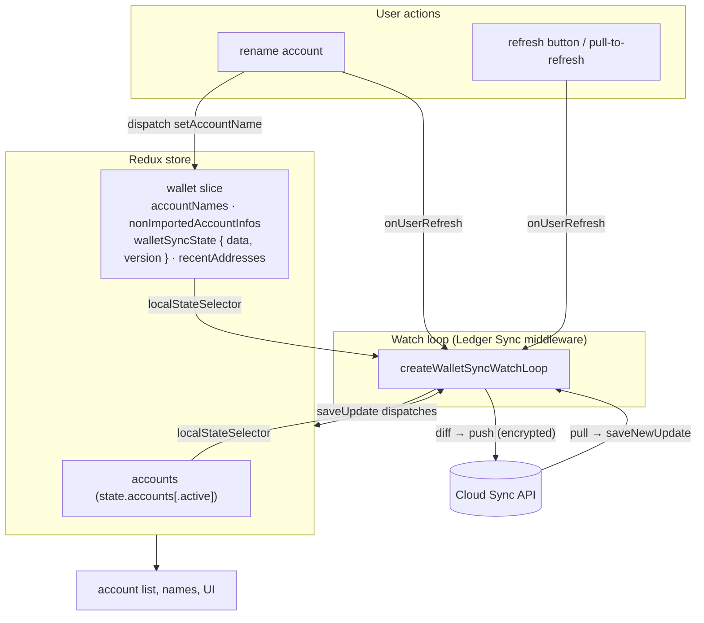

# 7 · App integration (Desktop & Mobile)

> How [the watch loop](./06-watch-loop.md) is wired into the two apps. Code:
> `apps/ledger-live-desktop` (LWD) and `apps/ledger-live-mobile` (LWM), under
> `src/mvvm/features/WalletSync/`.

The watch loop runs in the Ledger Sync middleware of `@features/platform-wallet-sync`. Each app
passes it its **selectors** and its **`save`** function, in `state-manager/middleware/ledgerSync.ts`,
and mounts the provider that starts it.

## The wiring

Each app mounts a `<WalletSyncProvider>` near the root (LWD `renderer/Default.tsx`, LWM
`AppProviders.tsx`). It dispatches `startLedgerSyncWatch()` on mount and `stopLedgerSyncWatch()`
on unmount. In between, the middleware:

1. runs the watch loop on the store's `TrustchainSDK` and `CloudSyncSDK` (see
   [Building the SDKs](#building-the-sdks)), with the app's selectors and `save`;
2. runs it only while the feature flag is on and `trustchain` + `memberCredentials` exist, and
   restarts it after an action changes one of them, the flag's `watchConfig` or the token
   blacklist;
3. keeps `visualPending` and the loop's last `walletSyncError` in the `ledgerSync` slice.

`useWalletSyncUserState()` reads them as `{ visualPending, walletSyncError, onUserRefresh }` for
the UI (refresh button, error badge), and `onUserRefresh` dispatches `refreshLedgerSync()`.



## What each app provides

| Contract | Desktop / Mobile implementation |
|---|---|
| `localStateSelector` | `{ accounts: { list, nonImportedAccountInfos }, accountNames, recentAddresses }` read from Redux. **LWD** reads `state.accounts`; **LWM** reads `state.accounts.active`. |
| `saveUpdate` | dispatches into Redux — see below. |
| `featureSelector` | the `lldWalletSync` / `llmWalletSync` flag: whether the loop runs, and its `watchConfig`. It sits at the top level of the middleware config, as the flag gates all of Ledger Sync; the getters are not gated, the screens that use them are. |

The middleware reads the latest distant data and version itself, with `selectWalletSyncState` of
`@domain/entity-wallet-sync`: the store mounts that slice at `wallet.walletSync`, and `saveUpdate`
writes to it. It also reads the Ledger Key Ring trustchain store itself, with the selectors and
actions of `@ledgerhq/ledger-key-ring-protocol/store`: the store mounts it at `trustchain`, and the
middleware restores it on `TrustchainOutdated` and empties it on `TrustchainEjected` /
`TrustchainNotAllowed`.

### The `saveUpdate` callback

This is the bridge from sync results back into the app store. On an incoming update it dispatches:

```ts
dispatch(walletSyncUpdate(data, version));          // persist distant state + version
if (newLocalState) {
  dispatch(setNonImportedAccounts(newLocalState.accounts.nonImportedAccountInfos));
  dispatch(setAccountNames(newLocalState.accountNames));
  dispatch(updateRecentAddresses(newLocalState.recentAddresses));
  dispatch(replaceAccounts(newLocalState.accounts.list)); // updates the global account list + DB
}
```

Account **names** are stored in a `Map<id, name>` (the `wallet` slice) and applied on top of the
UI via selectors; they are not part of the `Account` object itself.

### Building the SDKs

The Ledger Sync middleware builds the store's LKRP SDK (`TrustchainSDK`), Cloud Sync SDK, QR code
pairings and backend status on the first request, with `@ledgerhq/ledger-key-ring-protocol` and from
what `state-manager/middleware/ledgerSync.ts` passes in:

- `lkrp`: the LKRP URL, live-common's `withDevice`, and getters for the mock environment and the
  instance name. The SDK gets the context `{ applicationId: 16, name: <instance name>, apiBaseUrl }`.
- `cloudSync`: the selectors and `save` of `WalletSync/utils/walletsync.ts`. `walletsyncSelector` is
  memoized on the token blacklist, and a new walletsync restarts the watch loop.

Hooks reach them through `dispatch`, with `getLkrpSdk` (`useTrustchainSdk`), `getCloudSyncSdk` (the
backup deletion, which shares the watch loop's [lock](./04-cloud-sync-sdk.md#atomicity--versioning)),
`getLkrpQrCode` (the [QR code](./03-qr-code-protocol.md) hooks) and `getLedgerSyncStatus`. The URLs
come from the `ledgerKeyRing` switch of the [app config](../../shared/app-config/README.md).

With `cloudSync.reencryptOnRotation`, set on desktop only, the SDK re-encrypts the Cloud Sync data
on a [key rotation](./02-trustchain-sdk.md#key-rotation-on-member-removal): it deletes the data of
the old key and pushes it again with the new one.

## Feature flags & entry points

| | Desktop | Mobile |
|---|---|---|
| Feature flag | `lldWalletSync` | `llmWalletSync` |
| Accounts source | `state.accounts` | `state.accounts.active` |
| Manual refresh | top-bar `ActivityIndicator` | `RefreshControl` (pull-to-refresh) |
| Activation entry | Settings entry point + `WalletSync/Drawer` | `Settings/General/WalletSyncRow` + `ActivationDrawer` |

The activation/management UI is a multi-flow drawer — **Activation**, **Synchronize** (add an
instance, incl. [QR-code](./03-qr-code-protocol.md)), **ManageInstances**, **ManageBackup** —
backed by a dedicated `walletSync` UI reducer (flow/step/drawer visibility), separate from the
synced `wallet` data slice.

> [!NOTE]
> The `useDestroyTrustchain` hook calls
> [`destroyApplication`](./02-trustchain-sdk.md#deactivating-ledger-sync-per-application-close)
> instead of `destroyTrustchain`, so deactivating Ledger Sync no longer wipes other applications
> sharing the same trustchain root (e.g. the wallet-cli ring). No UI change — ejection is already
> handled by the watch-loop recovery.

> [!TIP]
> "One identity = one Ledger Wallet instance." Because the watch loop is per-instance, the
> [web-tools playground](./cookbook.md#test-on-the-web-tools-playground) can simulate many
> instances at once (one per browser tab) to test propagation between members.
