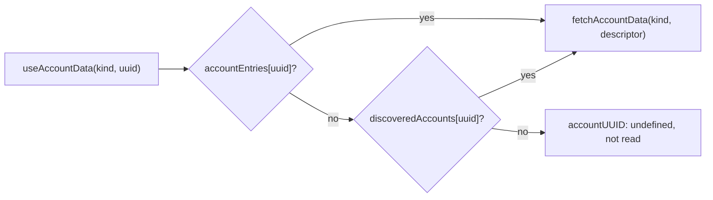

# @features/platform-account-data

> [!CAUTION]
> **Status: UNSTABLE.** API may change while the first screens adopt it.

`useAccountData(kind, accountUUID, { query, maxAge })` keeps one kind of data of one account read while mounted, and returns `{ accountUUID, pending, error, hasMore, refresh, loadMore }`. The screen reads the data with the entity's own selectors:

```ts
const query = { filterAsset: usdtId };
const { accountUUID, hasMore, loadMore } = useAccountData("operations", uuid, { query });
const operations = useSelector(state => selectAccountOperations(state, accountUUID, query));
```

`useAccountDataBatch(kind, accountUUIDs, { query, maxAge })` does the same for many accounts, for a figure that sums them (a portfolio total). It reads them in one tick, so the router groups them per source: one call per chunk of `maxBatchSize` on a source with a batch reader, else at most `concurrency` single reads at once, and returns `{ accountUUIDs, pending, errors, refresh }`:

```ts
const { pending } = useAccountDataBatch("balance", accountUUIDs);
const total = useSelector(state => selectTotal(state, accountUUIDs));
```

Both hooks take `AccountUUID`s and resolve each descriptor from the slices that hold one, both from `@domain/entity-account`: the `accounts` slice (`state.accountEntries`), then the `discoveredAccounts` register of the accounts a scan found and the user has not added, so a scan screen reads their balance. The descriptor never leaves this package, and an account neither slice holds is not read.



See [the account data layer](../../../docs/account-models/data-layer.md).
