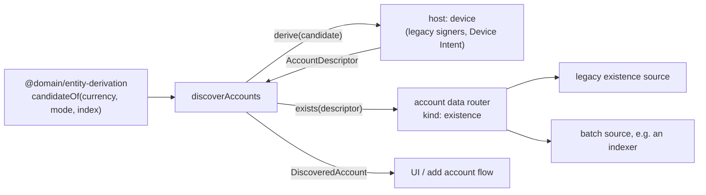

# @features/platform-account-discovery

> [!CAUTION]
> **Status: EXPLORATION** — API still being designed.

Account discovery as a stream: `discoverAccounts(host, { currencyId })` is an `Observable<DiscoveredAccount>`, in the order of the legacy `scanAccounts`. It answers "which accounts does this seed have on this currency", and nothing else: no `Account`, no sync, no store.

## What the host gives

- `derive(candidate, signal)`: the `AccountDescriptor` of an `AccountCandidate`, its key derived on the device (an xpub for a UTXO account, an address otherwise). Throws an `UnsupportedDerivation` when the device app has no such mode: the mode is skipped.
- `exists(descriptor, signal)`: whether the account has any history. `existsThroughRouter(router)` asks the `existence` kind of `@domain/entity-account-existence` to the app's sources.

## What it knows

The rules of `@domain/entity-derivation`: the modes of the currency, the gap limit, `startsAt`, non-iterable modes, the indexes a mode leaves to another, which mode offers a new account. Every used account is emitted, then the first empty account of a mode that can create one; a mode stops after `mandatoryEmptyAccountSkip` consecutive empty accounts.

## How fast

- `window: n` derives `n` accounts, then asks their existence in the same tick: a source with a batch reader checks them in one call.
- `lookahead: n` keeps `n` windows in flight: the device derives the next window while the current one is checked.

Derivations stay one at a time. The emitted accounts do not depend on either option, only what is wasted past the gap limit. Unsubscribing aborts what is in flight.

## Not covered yet

- Families scanned with an address lookup (several addresses per derived key).
- Families that need an onboarding before an account exists (Canton, Concordium, Aleo).
