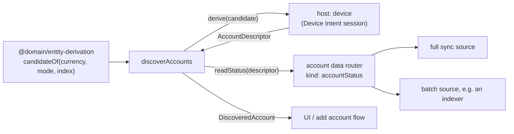

# @features/platform-account-discovery

> [!WARNING]
> **Status: UNSTABLE** — first implementation, its API may change.

Account discovery as a stream: `discoverAccounts(host, { currencyId })` is an `Observable<DiscoveredAccount>`, in the order of the legacy `scanAccounts`. It answers "which accounts does this seed have on this currency", and nothing else: no `Account`, no sync, no store.

## What the host gives

- `derive(candidate, signal)`: the `AccountDescriptor` of an `AccountCandidate`, its key derived on the device (an xpub for a UTXO account, a hex extended public key for Cardano and Kaspa, an address otherwise). Throws an `UnsupportedDerivation` when the device app has no such mode: the mode is skipped. Resolves `null` to end the mode there, keeping the accounts found before it, as the legacy scan's iterate does (Celo on an app too old for a path). Resolves `{ descriptor, keyHasMoreAccounts }` for an account looked up from a key (Hedera): while the key lists more accounts after it, an empty one does not count toward the gap limit, as the legacy `keyHasMoreAddresses`.
- `readStatus(descriptor, signal)`: whether the account was ever used, and its gate. `statusThroughRouter(router)` reads the `accountStatus` kind ([`@domain/entity-account-status`](../../../domain/entity/account-status)) from the app's sources.

## What it knows

The rules of `@domain/entity-derivation`: the modes of the currency, the gap limit, `startsAt`, non-iterable modes, the indexes a mode leaves to another, which mode offers a new account. Every used account is emitted, then the first empty account of a mode that can create one; a mode stops after `mandatoryEmptyAccountSkip` consecutive empty accounts. Each carries its `AccountStatus`: its gate tells an account to onboard first (Canton, Concordium).

## How fast

- `window: n` derives `n` accounts, then asks their status in the same tick: a source with a batch reader checks them in one call.
- `lookahead: n` keeps `n` windows in flight: the device derives the next window while the current one is checked.

Derivations stay one at a time. The emitted accounts do not depend on either option, only what is wasted past the gap limit: with `window: 1` and `lookahead: 1`, the device derives exactly what the legacy scan derives.

## Failures and cancellation

- Each account settles on its own: a failure surfaces once the scan reaches that account, so one past the gap limit is never seen.
- The scan completes or fails only once the device is idle: a derivation prefetched past the end of the last mode settles first. `deriveOnSession` also runs one call at a time per session, so a scan started after a stop waits for the stopped scan's call.
- Unsubscribing aborts the `signal` handed to `derive` and `readStatus`, and starts no new derivation or status read. `statusThroughRouter` forwards it to the router, which stops the source once no other read waits for the account.

## Parity notes

- The legacy env scan rules (`KEYCHAIN_OBSERVABLE_RANGE`, `SHOW_LEGACY_NEW_ACCOUNT`) are `ScanRules` the host passes; live-common's `legacyScanRules()` reads them, and the DevTools page passes them.
- The coin modules of TON, Canton and Concordium answer the status from the public key (`getAccountStatus`), with whether it is onboarded where that applies; the other families sync from the descriptor, Aleo with its public sync only, as the scan (no view key).
- Polkadot: once migrated, the scan of `polkadot` returns the account on `assethub_polkadot`; discovery keeps the `polkadot` descriptor, at the same path and with the same `used` (one sync, the migrated one). The account moves network when it is synced, not when it is discovered.
