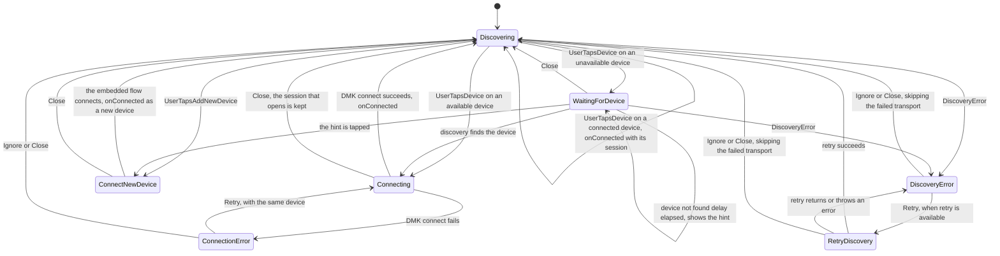

# ConnectKnownOrNewDeviceStateMachine

`ConnectKnownOrNewDeviceStateMachine` drives the device list of My Wallet. It
lists the known, connected and discovered devices with their status. It
connects to a device, disconnects or removes a device, and embeds the
`ConnectNewDeviceStateMachine` in shared mode to add a new device. It has no
end state: after each connection, it calls `onConnected` and goes back to the
list.

The diagram of reference is the "ConnectKnownOrNewDevice state machine" section
of the
[connectKnownOrNewDevice page in Lucid](https://lucid.app/lucidchart/2536447a-30cc-48ca-8607-643edd84d1f4/edit?page=0_0).

## State Diagram

## The device list

- The list has every connected device (known or not, also several), every
  known BLE device, and every discovered USB device. A discovered BLE device
  that is not known is not listed: the Add mode pairs it.
- A discovered device that matches a connected device shows once, as the
  connected device. One known device shows in one row.
- The statuses are `connected` (has a DMK session), `available` (discovered)
  and `unavailable` (known BLE device that discovery does not find). A USB row
  is never `unavailable`.
- The connectivity (BLE or USB) drives these rules, not the transport. A
  connected device takes it from `ConnectedDevice.type`, or from the injected
  `getConnectivity` when the type is `MOCK`. A discovered or known device takes
  it from `getConnectivity`, so that the mock server can test both.
- The injected `findMatchingDevice(device, candidates)` matches the connected
  and discovered devices with the known devices, and the discovered devices
  with the connected devices.
- The order is connected, then available, then unavailable. In each group, the
  last used device comes first (`lastUsedAt` of the known device). The devices
  without a last use time keep their order, after the others.
- A known device row shows the known device. Its key comes from the known
  device, so that it keeps its key when its status changes.
- Every state except `ConnectNewDevice` emits the list again when the known
  devices, the connected devices or the discovered devices change.
- While discovery is stopped, the list keeps the devices of the last scan.

## Notes

- The discovery service is the source of truth for the discovery state: the
  machine reads `isRunning` and `ignoredTransportIds` from it.
- Only `Discovering` accepts the device actions and Add. Its rows have
  `connect`, `disconnect` on a connected device, and `remove` on a known BLE
  device. A row action finds the device by its key in the current list, so a
  tap on a row from an older list follows the current status of the device, and
  a tap on a device that is no longer listed does nothing.
- `connect` on a connected device calls `onConnected` with its session.
- `disconnect` disconnects the session. `remove` disconnects the device first
  when it is connected, then calls `removeKnownDevice`. A failed disconnect
  writes a log, and the device is still removed.
- `WaitingForDevice` keeps discovery running and connects when discovery finds
  the device. After the device not found delay (`DEFAULT_DEVICE_NOT_FOUND_DELAY`,
  8 s, or `delays.deviceNotFoundDelay`), it emits `showDeviceNotFound: true`.
  `addNewDevice` opens the Add mode.
- `Connecting` stops discovery, disconnects every connected session, then calls
  `dmk.connect` with the session refresher disabled. Close goes back to the
  list without a disconnect: `onConnected` is just not called, and the list
  shows the session when it opens.
- `onConnected(result, { isNewDevice })`: `isNewDevice` is `true` when the
  device was not known, and always `true` after the Add mode.
- Discovery errors in `Discovering` and `WaitingForDevice` stop discovery and
  show the error over the list. `retry` is only set when the error has a
  resolution that is not `"none"`. Ignore and Close start discovery again
  without the failed transport. The selected device is not kept.
- `ConnectNewDevice` starts the embedded `ConnectNewDeviceStateMachine` in
  shared mode with the same discovery service, and stops it when it leaves.
  Discovery does not stop at these transitions. The embedded machine shows the
  discovery errors, and the parent ignores them. Its `Done` calls `onConnected`
  as a new device. The embedded delays come from `delays.connectNewDevice`.
- Every `onConnected` stops discovery and pauses the machine.

## Pause and resume

- `pause()` stops discovery. `resume()` starts it again in `Discovering`,
  `WaitingForDevice`, and `ConnectNewDevice` when the embedded flow discovers.
  In the other states, discovery starts again when the machine goes back to
  the list.
- `isPaused: true` starts the machine paused.
- After `onConnected`, the machine stays paused until `resume()`.
- A discovery error ignored while paused is kept: the next start skips its
  transport.

## stop and failures

- `stop()` stops discovery and the embedded machine. It never disconnects a
  session, also a session that is still opening.
- When an action, the embedded machine, the known devices or the connected
  devices fail, the machine stops discovery and sends the error to
  `observer.error`.
